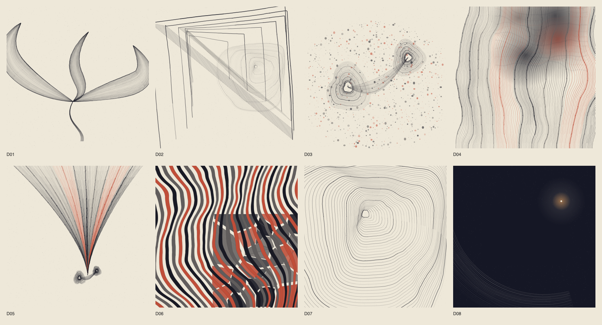
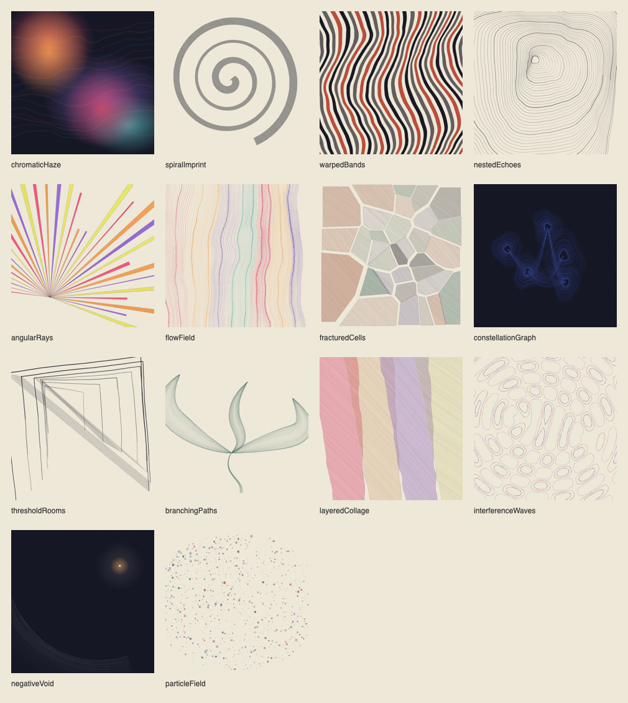

# DREAM Visual Grammar 1.0

Version 0.5 / build 9 replaces the three shared filament variants for **new** dreams with a versioned procedural print system. Home, voice/text capture, the notebook, local protection, DReAMy and the separate SLAMSS research workflow remain in place.



## Implemented pipeline

1. `NarrativeVisualAnalyzer` extracts conservative literal English cues. It recognizes motion, doors, branching, crowds, meetings, repetition, fractures, emptiness, light, simultaneous elements and transitions. Negated cues such as “no doors” are not treated as present. Sparse/empty input produces a valid, deliberately sparse chromatic field; audio-only entries retain the existing save-for-later flow.
2. `NarrativeModelAnalyzer` optionally requests structured, short cues from Apple Foundation Models. Types whitelist accepted kinds in code, limit to eight suggestions and counts 1–8, and reject quotations not found in the report after case/whitespace normalization. A model suggestion cannot replace a strong literal structural cue. This is conservative validation, not a proof of semantic correctness.
3. `VisualRuleEngine` chooses one primary family and zero or one secondary in the current default rules (the recipe supports up to two secondaries), concrete positions/directions/counts, a composition label and an artistic palette. Each choice carries source, rule, verified quotation where applicable and explanation. The palette does not come from an emotion label.
4. `DreamVisualRecipe` freezes grammar and renderer versions, a full `UInt64` seed, canonical text SHA-256, layers, sRGB colors, finish, source decisions and user adjustments. Counts and numeric ranges are checked before rendering and during diary decoding. No wall clock, health samples or text enter the renderer.
5. `ProceduralRenderEngine` builds a normalized, quantized `RenderPlan` with bounded points/marks. SplitMix64 and coherent three-octave value noise provide seeded variation. Geometry is independent of output resolution. A render-plan digest includes paint and grain as well as positions.
6. `ProceduralRasterizer` draws the plan with Core Graphics into sRGB pixels. Bitmap drawing/PNG encoding is serialized using `Synchronization.Mutex`; the returned pixels have immutable ownership. This resolved pixel differences found by concurrent repeat-render tests. `PortraitService` keeps a bounded local cache off the main actor; `PortraitImageLoader` also decodes/downsamples off the main actor.
7. `RecipeArtwork`/`DreamPortrait` display the same static print in Home, detail, notebook and thumbnails. The export uses the archived 1080 px PNG when available. No image-generation model, remote endpoint, photo texture, Pinterest asset, new iOS package or Metal shader is used.

## Fourteen implemented families



| Family | Actual structure |
| --- | --- |
| chromaticHaze | Five feathered elliptic color fields and low-opacity warped ribbons |
| spiralImprint | One thick Archimedean ribbon with varying width and coherent edge perturbation |
| warpedBands | Filled parallel ribbons, sinusoidal/fBm domain deformation |
| nestedEchoes | Offset nested contours with unequal spacing, pressure and organic deformation |
| angularRays | Unequal filled angular sectors from an asymmetric focus |
| flowField | Fixed-step polylines in a curl-perturbed vector field; upward, downward, crossing or converging |
| fracturedCells | Actual bounded Voronoi half-plane clipping, gaps and seeded cell shifts |
| constellationGraph | Organic contoured focal bodies with curved connections in renderer 2; retained spring/repulsion graph in renderer 1 |
| thresholdRooms | Open, displaced portals with clipped hatching and shadow planes |
| branchingPaths | Asymmetrical cubic ribbon bundles with pressure-varied ink; the retained renderer 1 uses recursive forks |
| layeredCollage | Four overlapping irregular cut-paper planes |
| interferenceWaves | Marching-squares contours of two interfering oscillator fields |
| negativeVoid | A dominant empty region, peripheral contours and a small focus only when supported by light cues |
| particleField | Bounded clustered Poisson-style rejection sampling with a spatial-neighbor grid |

These are distinct geometric algorithms, not labels applied to the same angular loop. See the [eight-story mapping](visual-grammar/NARRATIVE_MAPPING.md), [monochrome comparison](visual-grammar/monochrome-comparison.png) and [88 px thumbnails](visual-grammar/thumbnails-88.png). Seven primary topologies occur across the eight fixtures; D04 and D05 share a vector-field family with different direction, convergence and secondary structure.

## Source hierarchy and model limits

Explicit portrait refinements override finish/color choices. Supported literal story structure precedes model suggestions. DReAMy's independent AN/AP/SD/CO/HA presence hints make small, independently accumulated print-finish adjustments; they never select the primary topology or hue, and their scores are never treated as intensity. All five labels, including anger and apprehension, have supported hint handling. A user energy refinement supersedes those finish hints and records that override.

The person's selected `feeling` and stored `intensity` are preserved when the language model writes a reading. The new language-model tone/energy output is not allowed to replace those values. The legacy `suggestedMotif` property remains solely to explain historical portraits; new composition does not call it.

The written personal reflection remains separate from `Why this drawing?`. Classifier hints are explicitly fallible; the writer is instructed not to replace stated clarity/calm/safety with a conflicting label or describe a generated motif as a reported scene. This is not clinical validation or a guarantee of model faithfulness. On the physical D01 check, DReAMy suggested confusion, while the geometry correctly kept the story's three paths.

DReAMy remains English-only, with a 510-content-token limit and its existing truncation notice. Foundation Models receives at most 5,000 characters; local fallback can examine the full report. Analysis limits are recorded where relevant. Quotes are checked against original text; this does not make every model-proposed interpretation of a quote true.

Health data remains optional stored context and is **not used by V1 geometry or export**. No SLAMSS inference runs on the iPhone. Its external research adapter/import and source-separated Health sleep stages are unchanged. No simulated night data has been added.

## Saving, edits and legacy safety

- Old JSON without new fields or even `motif` decodes using explicit defaults. Old entries keep `DreamCanvas`, not an unsolicited V1 migration.
- Before a historical text/feeling/intensity edit, legacy seed/appearance is frozen. New recipes and static PNGs also remain unchanged by text edits or by requesting another written reading.
- `portraitUsesEarlierText` flags a changed canonical story. **Recreate portrait from edited dream** opens a preview before replacement.
- **Refine portrait** has three initial choices: visual intensity, colors and exploring another composition. Exploration changes the seed and bounded arrangement within story-led constraints. Cancel changes nothing; **Use portrait** commits the preview. User choices and overridden hints are traceable.
- PNGs are separate protected, atomically written `portraits/<entry-id>-<recipe-identity>.png` files, not blobs in `dreams.json`. Snapshot creation precedes the atomic journal write, with rollback on failure; an old snapshot is deleted only after success. Existing snapshots survive metadata saves from stale entry copies. Deletion uses the actual saved record and only cleans scoped files belonging to that entry.
- A corrupt journal or unsupported/invalid recipe is preserved and not overwritten. Audio belonging to other records is not deleted.
- V1 algorithms and palettes are frozen by version and explicit serialized colors. Future changes require another renderer/grammar version; archival PNGs preserve the original print if platform rasterization changes.

## Motion and accessibility

V1 new portraits are **static by design**, with no recurring frame work, flashing or dependence on heart rate/time. This supplies a complete Reduce Motion presentation and avoids background animation. `MotionRecipe` is reserved for a future opt-in restrained animation; no animated V1 feature is claimed. The retained legacy view already honors Reduce Motion/scene phase and is shown statically in the journal/detail/export path.

Portraits have compact VoiceOver descriptions of visible geometry, rather than emotion scores. The notebook keeps handwriting-relative text and paper. Home actions use `ViewThatFits` to stack at larger text sizes; portrait refinement and explanations scroll. Automated checks cover largest Dynamic Type entry into Write. Manual VoiceOver, iPad/folding-screen coverage and broader accessibility review remain to do.

## Reproduce the gallery

On macOS with Xcode and its Swift toolchain:

```sh
python3 scripts/render_visual_gallery.py --output /private/tmp/DREAM-gallery
open /private/tmp/DREAM-gallery/index.html
```

The script compiles the **same production geometry and Core Graphics source files** into a macOS command-line exporter. It produces all eight fixed-seed fixtures at 88, 390 and 1080 px, monochrome comparisons, fourteen family examples, recipe JSON, a source/rule table and measured native-macOS timings. No AI/model/Health inference or external image asset is needed for this gallery. App and tool share the normalized render plan; OS/size antialiasing is not assumed identical across platforms.

The input package, original brief and Pinterest moodboard remain outside the public source tree. Only synthetic fixtures, newly generated prints, code and technical documentation are published.


## Ink/graphite revision

[Art direction and researched sources](ART_DIRECTION.md) explain the Redon/Masson/Fred Deux references and their translation into original procedural strokes. New recipes use renderer 2; old recipes without that field retain renderer 1. Opening Refine previews an ink study without replacing the saved PNG until confirmation.
